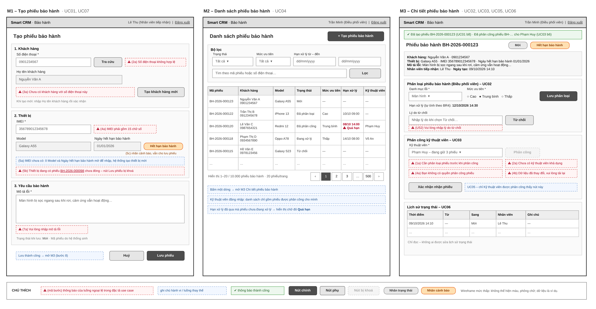

# BÀI TẬP 1 – PHÂN TÍCH VÀ THIẾT KẾ

---

| | |
|---|---|
| **Học phần** | Chuyên đề tốt nghiệp 1 – Học kỳ 1, năm học 2026 – 2027 |
| **Case study** | Smart CRM – Mekong Mobile |
| **Luồng nghiệp vụ** | L2 – Tiếp nhận và phân loại yêu cầu bảo hành |
| **Track** | SE |
| **Sinh viên** | `MINGBOUPPHA XAYKHAM` – `237480201is11` – `261_71ITGR40203_03` |
| **Ngày nộp** | `<19/10/2026>` |
| **GitHub repo** | https://github.com/Tolexengnaa/237480201is11-warranty-app |

> File này là nguồn Markdown của file PDF nộp (`BT1_237480201is11_MingbouphaXaykham.pdf`). Sơ đồ gốc nằm cùng thư mục `docs/` (`*.drawio`); ảnh xuất nằm trong `docs/export/`; DDL nằm ở `db/schema.sql`.

---

## MỤC 1 – BẢN SRS RÚT GỌN

### 1.1. Giới thiệu và phạm vi

#### 1.1.1. Bối cảnh

Mekong Mobile tiếp nhận yêu cầu bảo hành thiết bị (điện thoại, máy tính bảng) tại cửa hàng. Hiện nay việc ghi nhận còn thủ công nên khó biết phiếu nào đang chờ, phiếu nào trễ hạn và ai đang xử lý. Luồng **L2** số hoá đoạn từ lúc khách mang thiết bị đến cửa hàng cho tới khi **phiếu bảo hành** được phân loại, đặt **mức ưu tiên** và giao cho **kỹ thuật viên**.

#### 1.1.2. Phạm vi

**Trong phạm vi (L2):** tạo phiếu bảo hành; phân loại theo danh mục lỗi và đặt mức ưu tiên; phân công kỹ thuật viên; tra cứu danh sách phiếu; cập nhật trạng thái và lưu lịch sử trạng thái.

**Chủ ý KHÔNG làm (mức WON'T của MoSCoW):**

- Gửi SMS / email thông báo cho khách hàng (FR6).
- Quá trình sửa chữa, quản lý linh kiện, trả máy cho khách (các bước sau trạng thái *Đang xử lý*).
- Tính phí sửa chữa cho thiết bị hết hạn bảo hành, thanh toán.
- Khách hàng tự tạo phiếu trực tuyến; báo cáo thống kê.

#### 1.1.3. Bảng thuật ngữ

Toàn bộ tài liệu, sơ đồ, ERD và wireframe chỉ dùng **đúng một tên** cho mỗi khái niệm dưới đây.

| Thuật ngữ (dùng trong tài liệu) | Tên trong CSDL / mã nguồn | Định nghĩa |
|---|---|---|
| Phiếu bảo hành | `ticket` | Bản ghi một lần khách yêu cầu bảo hành cho một thiết bị. |
| Mã phiếu | `ticket.ticket_code` | Mã duy nhất dạng `BH-YYYY-NNNNNN`, do hệ thống sinh. |
| Khách hàng | `customer` | Người mang thiết bị đến bảo hành; định danh bằng số điện thoại. |
| Thiết bị | `device` | Điện thoại/máy tính bảng của khách; định danh bằng IMEI. |
| Ngày hết hạn bảo hành | `device.warranty_end_date` | Ngày cuối cùng thiết bị còn được bảo hành. |
| Hết hạn bảo hành | tính khi hiển thị: `ticket.created_at` > `device.warranty_end_date` | Nhãn cảnh báo trên phiếu bảo hành của thiết bị đã quá ngày hết hạn bảo hành (BR3); không lưu thành cột. |
| Danh mục lỗi | `issue_category` | Nhóm lỗi dùng để phân loại phiếu (Màn hình, Pin, Nguồn, Phần mềm…). |
| Mức ưu tiên | `ticket.priority` | Một trong ba giá trị: **Cao**, **Trung bình**, **Thấp** (mã `HIGH` / `MEDIUM` / `LOW`). |
| Hạn xử lý | `ticket.due_date` | Thời điểm phiếu phải được xử lý xong, tính theo mức ưu tiên (BR4). |
| Trạng thái phiếu | `ticket.status` | **Mới → Đã phân loại → Đã phân công → Đang xử lý**; hoặc **Từ chối** (mã `NEW` → `CLASSIFIED` → `ASSIGNED` → `IN_PROGRESS`; `REJECTED`). |
| Lịch sử trạng thái | `ticket_status_log` | Bản ghi mỗi lần trạng thái phiếu thay đổi: ai đổi, đổi từ gì sang gì, lúc nào. |
| Nhân viên | `staff` | Người dùng nội bộ của hệ thống; có đúng một vai trò. |
| Nhân viên tiếp nhận | `staff.role = RECEPTIONIST` | Nhân viên tại quầy, tạo phiếu bảo hành. |
| Điều phối viên | `staff.role = COORDINATOR` | Nhân viên phân loại, đặt mức ưu tiên và phân công phiếu. |
| Kỹ thuật viên | `staff.role = TECHNICIAN` | Nhân viên nhận phiếu được phân công để xử lý. |


### 1.2. Các bên liên quan và vai trò

| Vai trò | Được làm | Không được làm |
|---|---|---|
| **Nhân viên tiếp nhận** | Tra cứu khách hàng theo số điện thoại; tạo khách hàng mới; tạo phiếu bảo hành; xem danh sách và chi tiết phiếu. | Phân loại, đặt mức ưu tiên, phân công; chuyển trạng thái phiếu. |
| **Điều phối viên** | Mọi quyền xem; phân loại và đặt mức ưu tiên; phân công kỹ thuật viên; chuyển phiếu *Mới* sang *Từ chối* kèm lý do. | Xoá phiếu; sửa lịch sử trạng thái. |
| **Kỹ thuật viên** | Xem phiếu được phân công cho mình; chuyển phiếu *Đã phân công → Đang xử lý*. | Xem phiếu của kỹ thuật viên khác; phân loại; phân công; từ chối phiếu. |


### 1.3. Yêu cầu chức năng

#### 1.3.1. Danh sách yêu cầu chức năng

| Mã | Yêu cầu (phát biểu kiểm chứng được) | MoSCoW |
|---|---|---|
| **FR1** | Hệ thống cho phép Nhân viên tiếp nhận tạo phiếu bảo hành từ số điện thoại khách hàng, IMEI thiết bị và mô tả lỗi. Khi lưu, hệ thống sinh mã phiếu duy nhất, đặt trạng thái **Mới** và đánh dấu thiết bị còn/hết hạn bảo hành dựa trên ngày hết hạn bảo hành. | MUST |
| **FR2** | Hệ thống cho phép Điều phối viên chọn danh mục lỗi và mức ưu tiên cho phiếu ở trạng thái **Mới**; khi lưu, trạng thái thành **Đã phân loại** và hạn xử lý được tính theo BR4. Thay vì phân loại, Điều phối viên có thể chuyển phiếu sang **Từ chối** kèm lý do bắt buộc. | MUST |
| **FR3** | Hệ thống cho phép Điều phối viên phân công phiếu **Đã phân loại** cho đúng một kỹ thuật viên đang hoạt động; khi lưu, trạng thái thành **Đã phân công**. | MUST |
| **FR4** | Hệ thống hiển thị danh sách phiếu bảo hành, lọc được theo trạng thái, mức ưu tiên, khoảng hạn xử lý; tìm theo mã phiếu hoặc số điện thoại; phân trang 20 phiếu/trang; phiếu quá hạn xử lý được đánh dấu. | SHOULD |
| **FR5** | Mỗi lần trạng thái phiếu thay đổi, hệ thống ghi một bản ghi lịch sử trạng thái (trạng thái cũ, trạng thái mới, nhân viên thực hiện, thời điểm) và hiển thị trên màn hình chi tiết phiếu. | SHOULD |
| **FR6** | Hệ thống gửi SMS cho khách hàng khi trạng thái phiếu thay đổi. | WON'T |

#### 1.3.2. User Story

| Mã | User Story | MoSCoW | Tiêu chí chấp nhận (cho story MUST) |
|---|---|---|---|
| **US1** | Là **Nhân viên tiếp nhận**, tôi muốn tạo phiếu bảo hành bằng số điện thoại khách hàng và IMEI, để yêu cầu của khách được ghi nhận với một mã phiếu duy nhất. | MUST | (1) Nhập SĐT đã có → tự điền tên khách hàng. (2) SĐT chưa có → tạo khách hàng mới ngay trên màn hình. (3) Lưu thành công → hiện mã phiếu `BH-YYYY-NNNNNN`, trạng thái *Mới*. (4) IMEI đang có phiếu chưa đóng → không cho lưu, báo lỗi (BR2). |
| **US2** | Là **Điều phối viên**, tôi muốn chọn danh mục lỗi và mức ưu tiên cho phiếu mới, để phiếu gấp được xử lý trước. | MUST | (1) Chỉ phiếu *Mới* mới phân loại được. (2) Bắt buộc chọn cả danh mục lỗi và mức ưu tiên. (3) Sau khi lưu, hạn xử lý hiển thị đúng BR4. (4) Chọn *Từ chối* mà để trống lý do → không cho lưu. |
| **US3** | Là **Điều phối viên**, tôi muốn giao phiếu đã phân loại cho một kỹ thuật viên, để mỗi phiếu có người chịu trách nhiệm. | MUST | (1) Danh sách chọn chỉ gồm kỹ thuật viên đang hoạt động. (2) Phiếu chưa phân loại → nút phân công bị khoá. (3) Người không phải Điều phối viên gọi chức năng → bị từ chối ở máy chủ (NFR4). |
| **US4** | Là **Điều phối viên**, tôi muốn xem danh sách phiếu lọc theo trạng thái và hạn xử lý, để biết phiếu nào sắp trễ. | SHOULD | — |
| **US5** | Là **Kỹ thuật viên**, tôi muốn xác nhận đã nhận phiếu được giao, để Điều phối viên biết phiếu đang được xử lý. | SHOULD | — |
| **US6** | Là **Điều phối viên**, tôi muốn xem lịch sử trạng thái của một phiếu, để biết ai đã thay đổi gì và vào lúc nào. | SHOULD | — |
| **US7** | Là **khách hàng**, tôi muốn nhận SMS khi phiếu bảo hành đổi trạng thái, để không phải gọi điện hỏi. | WON'T | — |


### 1.4. Yêu cầu phi chức năng

| Mã | Loại | Yêu cầu và ngưỡng đo được | Cách đo |
|---|---|---|---|
| **NFR1** | Hiệu năng | Màn hình danh sách phiếu (FR4) trả về trang đầu trong **≤ 2 giây** (phân vị 95) với **10.000** phiếu bảo hành trong CSDL. | Sinh 10.000 bản ghi mẫu, đo 50 lần gọi API danh sách. |
| **NFR2** | Khả dụng | Nhân viên tiếp nhận mới tạo xong một phiếu bảo hành trong **≤ 3 phút** và **≤ 3 màn hình**, sau tối đa **15 phút** hướng dẫn. | Thử với 5 người, bấm giờ. |
| **NFR3** | Bảo trì | Thay đổi một quy tắc nghiệp vụ (BR1–BR6) chỉ phải sửa **đúng 1 module** của lớp nghiệp vụ; **0** thay đổi ở lớp giao diện. | Đếm số file bị sửa trong commit thay đổi quy tắc. |
| **NFR4** | Bảo mật | **100%** API thay đổi phiếu kiểm tra vai trò ở máy chủ; **0** lần phân loại/phân công thành công khi người gọi không phải Điều phối viên. | Bộ ≥ 10 ca kiểm thử phân quyền, tỉ lệ đạt 100%. |
| **NFR5** | Toàn vẹn dữ liệu | **100%** thay đổi trạng thái phiếu có đúng 1 bản ghi lịch sử trạng thái tương ứng; không có trường hợp phiếu đổi trạng thái mà thiếu lịch sử. | Truy vấn đối chiếu số lần đổi trạng thái với số bản ghi `ticket_status_log`. |


### 1.5. Ràng buộc và quy tắc nghiệp vụ

| Mã | Quy tắc | Nguồn |
|---|---|---|
| **BR1** | Mỗi phiếu bảo hành gắn với đúng **một** khách hàng và **một** thiết bị. | `<Bảng 9.1 – đối chiếu>` |
| **BR2** | Một IMEI chỉ có **tối đa một** phiếu chưa đóng (*Mới, Đã phân loại, Đã phân công, Đang xử lý*) tại một thời điểm. | Phân tích của em |
| **BR3** | Thiết bị có ngày tiếp nhận sau ngày hết hạn bảo hành vẫn được tạo phiếu nhưng phiếu bị đánh dấu **Hết hạn bảo hành**; Điều phối viên quyết định tiếp nhận hay chuyển *Từ chối*. | `<Bảng 9.1 – đối chiếu>` |
| **BR4** | Hạn xử lý = thời điểm phân loại + **24 giờ** (Cao) / **72 giờ** (Trung bình) / **120 giờ** (Thấp). | `<Bảng 9.1 – đối chiếu>` |
| **BR5** | Chỉ Điều phối viên được phân loại, phân công và từ chối phiếu; chỉ phân công phiếu *Đã phân loại* cho kỹ thuật viên đang hoạt động. | Phân tích của em |
| **BR6** | Trạng thái chỉ đi theo thứ tự *Mới → Đã phân loại → Đã phân công → Đang xử lý*, không quay lui; *Từ chối* chỉ được chọn khi phiếu đang ở trạng thái *Mới* và phải có lý do. Phiếu không bao giờ bị xoá. | Phân tích của em |


### 1.6. Bảng truy vết yêu cầu

| Yêu cầu chức năng | User Story | Use Case | MoSCoW | Bảng dữ liệu | Màn hình |
|---|---|---|---|---|---|
| FR1 · Tạo phiếu bảo hành | US1 | UC01 Tạo phiếu bảo hành (include UC07 Tra cứu khách hàng) | MUST | customer, device, ticket | M1 Tạo phiếu bảo hành |
| FR2 · Phân loại và đặt mức ưu tiên | US2 | UC02 Phân loại phiếu bảo hành | MUST | ticket, issue_category | M3 Chi tiết phiếu bảo hành |
| FR3 · Phân công kỹ thuật viên | US3 | UC03 Phân công kỹ thuật viên | MUST | ticket, staff | M3 Chi tiết phiếu bảo hành |
| FR4 · Tra cứu danh sách phiếu | US4 | UC04 Tra cứu danh sách phiếu | SHOULD | ticket (index `status`, `due_date`) | M2 Danh sách phiếu bảo hành |
| FR5 · Cập nhật trạng thái và lưu lịch sử | US5, US6 | UC05 Cập nhật trạng thái phiếu; UC06 Xem lịch sử trạng thái | SHOULD | ticket, ticket_status_log, staff | M3 Chi tiết phiếu bảo hành |
| FR6 · Gửi SMS cho khách hàng | US7 | Không có (ngoài phạm vi) | WON'T | Không có (ngoài phạm vi) | Không có (ngoài phạm vi) |

**Kiểm tra ngược:** mọi bảng của ERD (`customer`, `device`, `ticket`, `issue_category`, `staff`, `ticket_status_log`) đều xuất hiện ít nhất một lần ở cột *Bảng dữ liệu*; mọi FR mức MUST/SHOULD đều có User Story, Use Case, bảng và màn hình.

---

## MỤC 2 – USE CASE

**File sơ đồ gốc:** `docs/usecase.drawio`

### 2.1. Use Case Diagram


| Mã | Tên use case | Actor | FR / US |
|---|---|---|---|
| UC01 | Tạo phiếu bảo hành | Nhân viên tiếp nhận | FR1 / US1 |
| UC02 | Phân loại phiếu bảo hành | Điều phối viên | FR2 / US2 |
| UC03 | Phân công kỹ thuật viên | Điều phối viên | FR3 / US3 |
| UC04 | Tra cứu danh sách phiếu | Nhân viên tiếp nhận, Điều phối viên, Kỹ thuật viên | FR4 / US4 |
| UC05 | Cập nhật trạng thái phiếu | Kỹ thuật viên | FR5 / US5 |
| UC06 | Xem lịch sử trạng thái | Điều phối viên | FR5 / US6 |
| UC07 | Tra cứu khách hàng | (được UC01 «include») | FR1 / US1 |

### 2.2. Đặc tả use case UC01 – Tạo phiếu bảo hành


| Mục | Nội dung |
|---|---|
| **Actor chính** | Nhân viên tiếp nhận |
| **Mục tiêu** | Ghi nhận yêu cầu bảo hành của khách hàng thành một phiếu bảo hành có mã phiếu duy nhất. |
| **Điều kiện trước** | Nhân viên tiếp nhận đã đăng nhập; khách hàng đang có mặt tại quầy cùng thiết bị. |
| **Điều kiện sau (thành công)** | Có một phiếu bảo hành mới ở trạng thái **Mới**, có mã phiếu `BH-YYYY-NNNNNN`; có 1 bản ghi lịch sử trạng thái (→ *Mới*). |
| **Điều kiện sau (thất bại)** | Không có phiếu bảo hành nào được tạo. |
| **User Story liên quan** | US1 (FR1; quy tắc BR1, BR2, BR3) |

**Luồng chính**

1. Nhân viên tiếp nhận chọn **Tạo phiếu bảo hành** trên màn hình M2; hệ thống mở màn hình M1.
2. Nhân viên tiếp nhận nhập số điện thoại khách hàng.
3. Hệ thống tra cứu khách hàng (UC07) và hiển thị họ tên khách hàng.
4. Nhân viên tiếp nhận nhập IMEI thiết bị.
5. Hệ thống tìm thiết bị theo IMEI, hiển thị model và ngày hết hạn bảo hành, đồng thời kiểm tra BR2.
6. Nhân viên tiếp nhận nhập mô tả lỗi và chọn **Lưu phiếu**.
7. Hệ thống kiểm tra dữ liệu, sinh mã phiếu, lưu phiếu bảo hành ở trạng thái **Mới** và ghi lịch sử trạng thái trong cùng một giao dịch.
8. Hệ thống hiển thị thông báo *"Đã tạo phiếu BH-2026-000123"* và mở màn hình M3 của phiếu vừa tạo.

**Luồng ngoại lệ**

| Bước | Tình huống | Hệ thống xử lý |
|---|---|---|
| 2a | Số điện thoại sai định dạng (không đủ 10 chữ số) | Hệ thống hiển thị *"Số điện thoại không hợp lệ"* dưới ô số điện thoại; quay lại bước 2. |
| 3a | Không tìm thấy khách hàng | Hệ thống hiển thị *"Chưa có khách hàng với số điện thoại này"* và nút **Tạo khách hàng mới**; Nhân viên tiếp nhận nhập họ tên khách hàng và xác nhận; hệ thống tạo khách hàng; quay lại bước 4. |
| 4a | IMEI không đủ 15 chữ số | Hệ thống hiển thị *"IMEI phải gồm 15 chữ số"*; quay lại bước 4. |
| 5a | IMEI chưa có trong hệ thống | Hệ thống hiển thị thêm ô **Model** và **Ngày hết hạn bảo hành**; Nhân viên tiếp nhận nhập hai trường này; hệ thống tạo thiết bị gắn với khách hàng; tiếp tục bước 6. |
| 5b | Thiết bị đang có phiếu chưa đóng (vi phạm BR2) | Hệ thống hiển thị *"Thiết bị đang có phiếu BH-… chưa đóng"* kèm liên kết tới phiếu đó và khoá nút **Lưu phiếu**; use case kết thúc, không tạo phiếu. |
| 5c | Thiết bị đã hết hạn bảo hành (BR3) | Hệ thống hiển thị nhãn cảnh báo **Hết hạn bảo hành**; tiếp tục bước 6; nhãn *Hết hạn bảo hành* tiếp tục hiển thị trên M3 của phiếu (tính từ ngày hết hạn bảo hành, không lưu thành cột). |
| 7a | Mô tả lỗi để trống | Hệ thống hiển thị *"Vui lòng nhập mô tả lỗi"*; quay lại bước 6. |

---

## MỤC 3 – THIẾT KẾ KIẾN TRÚC

**File sơ đồ gốc:** `docs/architecture.drawio`

### 3.1. Sơ đồ kiến trúc phân lớp


Hệ thống là **một ứng dụng web nguyên khối chia 4 lớp** (Giao diện → API → Nghiệp vụ → Truy cập dữ liệu) dùng một CSDL PostgreSQL; lớp trên chỉ gọi lớp liền dưới. Trách nhiệm của từng lớp và cách các lớp trao đổi được ghi trực tiếp trên sơ đồ. **StatusService** là nơi duy nhất đổi trạng thái phiếu và ghi lịch sử trạng thái.

**Ngoài phạm vi:** cổng gửi SMS cho khách hàng (FR6 – WON'T); luồng sửa chữa, linh kiện, trả máy; thiết kế triển khai, máy chủ, mạng; đăng ký tài khoản và quản lý nhân viên (dữ liệu `staff` được nạp sẵn).

### 3.2. Lập luận lựa chọn kiến trúc

1. **Vì NFR3** yêu cầu thay đổi một quy tắc nghiệp vụ chỉ phải sửa **đúng 1 module** và **0** thay đổi ở lớp giao diện, **tôi chọn** kiến trúc 4 lớp trong một ứng dụng nguyên khối và đặt mỗi nhóm quy tắc vào đúng một service (ghi trên sơ đồ ở mục 3.1), **đánh đổi là** mỗi chức năng phải đi qua đủ 4 lớp nên phải viết thêm 2–3 file trung gian (controller, DTO, repository) so với để controller truy vấn thẳng CSDL.

2. **Vì NFR1** yêu cầu trang đầu danh sách phiếu bảo hành trả về trong **≤ 2 giây (p95) với 10.000 phiếu**, **tôi chọn** lọc và phân trang 20 dòng ngay trong CSDL ở TicketRepository, kèm index ghép `(status, due_date)` trên bảng `ticket`, thay vì tải hết dữ liệu lên rồi lọc ở giao diện, **đánh đổi là** mỗi lần thêm hoặc cập nhật phiếu CSDL phải cập nhật thêm index nên ghi chậm hơn một chút và tốn thêm dung lượng lưu trữ.

3. **Vì NFR4** yêu cầu **0** lần phân loại/phân công thành công khi người gọi không phải Điều phối viên, **tôi chọn** kiểm tra vai trò ngay trong ClassifyService và AssignService dựa trên người gọi do AuthMiddleware xác thực, thay vì chỉ ẩn nút trên giao diện, **đánh đổi là** mọi hàm nghiệp vụ phải nhận thêm tham số người gọi và phải viết thêm ít nhất 10 ca kiểm thử phân quyền.

4. **Vì NFR5** yêu cầu **100%** lần đổi trạng thái phiếu có đúng 1 bản ghi lịch sử, **tôi chọn** để StatusService là nơi duy nhất cập nhật `ticket.status` và ghi `ticket_status_log` trong **cùng một giao dịch CSDL**, **đánh đổi là** TicketService, ClassifyService và AssignService đều phụ thuộc vào StatusService, nên khi sửa StatusService phải kiểm thử lại cả ba service này.

---

## MỤC 4 – MÔ HÌNH DỮ LIỆU (TRACK SE)

**File sơ đồ gốc:** `docs/erd.drawio` · **DDL:** `db/schema.sql`

### 4.1. ERD


ERD gồm **6 bảng**, mỗi bảng có khoá chính thay thế `id`, **7 khoá ngoại**, không có bảng cô lập. Nhãn *Hết hạn bảo hành* và số phiếu kỹ thuật viên đang giữ được tính khi truy vấn, không lưu thành cột; `ticket` không lưu `customer_id` vì suy ra được qua `device` (3NF). Index `(status, due_date)` phục vụ NFR1; UNIQUE một phần trên `ticket.device_id` khi phiếu chưa đóng thực thi BR2.

### 4.2. SQL DDL skeleton (PostgreSQL 16)

```sql
CREATE TABLE customer (
    id          BIGSERIAL     PRIMARY KEY,
    full_name   VARCHAR(100)  NOT NULL,
    phone       VARCHAR(10)   NOT NULL UNIQUE
                CHECK (phone ~ '^[0-9]{10}$'),
    created_at  TIMESTAMPTZ   NOT NULL DEFAULT now()
);
CREATE TABLE device (
    id                 BIGSERIAL     PRIMARY KEY,
    customer_id        BIGINT        NOT NULL REFERENCES customer (id),
    imei               CHAR(15)      NOT NULL UNIQUE
                       CHECK (imei ~ '^[0-9]{15}$'),
    model              VARCHAR(100)  NOT NULL,
    warranty_end_date  DATE          NOT NULL,
    created_at         TIMESTAMPTZ   NOT NULL DEFAULT now()
);
CREATE INDEX idx_device_customer ON device (customer_id);
CREATE TABLE issue_category (
    id         BIGSERIAL     PRIMARY KEY,
    code       VARCHAR(20)   NOT NULL UNIQUE,
    name       VARCHAR(100)  NOT NULL UNIQUE,
    is_active  BOOLEAN       NOT NULL DEFAULT TRUE
);
CREATE TABLE staff (
    id             BIGSERIAL     PRIMARY KEY,
    username       VARCHAR(50)   NOT NULL UNIQUE,
    password_hash  VARCHAR(255)  NOT NULL,
    full_name      VARCHAR(100)  NOT NULL,
    role           VARCHAR(20)   NOT NULL
                   CHECK (role IN ('RECEPTIONIST', 'COORDINATOR', 'TECHNICIAN')),
    is_active      BOOLEAN       NOT NULL DEFAULT TRUE,
    created_at     TIMESTAMPTZ   NOT NULL DEFAULT now()
);
CREATE TABLE ticket (
    id                 BIGSERIAL     PRIMARY KEY,
    ticket_code        VARCHAR(14)   NOT NULL UNIQUE
                       CHECK (ticket_code ~ '^BH-[0-9]{4}-[0-9]{6}$'),
    device_id          BIGINT        NOT NULL REFERENCES device (id),
    issue_description  TEXT          NOT NULL CHECK (length(trim(issue_description)) > 0),
    issue_category_id  BIGINT        REFERENCES issue_category (id),
    priority           VARCHAR(10)
                       CHECK (priority IN ('HIGH', 'MEDIUM', 'LOW')),
    due_date           TIMESTAMPTZ,
    status             VARCHAR(20)   NOT NULL DEFAULT 'NEW'
                       CHECK (status IN ('NEW', 'CLASSIFIED', 'ASSIGNED', 'IN_PROGRESS', 'REJECTED')),
    assigned_to        BIGINT        REFERENCES staff (id),
    created_by         BIGINT        NOT NULL REFERENCES staff (id),
    created_at         TIMESTAMPTZ   NOT NULL DEFAULT now(),
    updated_at         TIMESTAMPTZ   NOT NULL DEFAULT now(),
    CONSTRAINT chk_ticket_classified CHECK (
        status IN ('NEW', 'REJECTED')
        OR (issue_category_id IS NOT NULL AND priority IS NOT NULL AND due_date IS NOT NULL)
    ),
    CONSTRAINT chk_ticket_assigned CHECK (
        status NOT IN ('ASSIGNED', 'IN_PROGRESS') OR assigned_to IS NOT NULL
    )
);
CREATE INDEX idx_ticket_status_due   ON ticket (status, due_date);
CREATE INDEX idx_ticket_assigned     ON ticket (assigned_to, status);
CREATE INDEX idx_ticket_device       ON ticket (device_id);
CREATE UNIQUE INDEX ux_ticket_open_device ON ticket (device_id)
    WHERE status IN ('NEW', 'CLASSIFIED', 'ASSIGNED', 'IN_PROGRESS');
CREATE TABLE ticket_status_log (
    id           BIGSERIAL    PRIMARY KEY,
    ticket_id    BIGINT       NOT NULL REFERENCES ticket (id),
    from_status  VARCHAR(20)
                 CHECK (from_status IN ('NEW', 'CLASSIFIED', 'ASSIGNED', 'IN_PROGRESS', 'REJECTED')),
    to_status    VARCHAR(20)  NOT NULL
                 CHECK (to_status IN ('NEW', 'CLASSIFIED', 'ASSIGNED', 'IN_PROGRESS', 'REJECTED')),
    note         TEXT,
    changed_by   BIGINT       NOT NULL REFERENCES staff (id),
    changed_at   TIMESTAMPTZ  NOT NULL DEFAULT now(),
    CONSTRAINT chk_log_reject_reason CHECK (
        to_status <> 'REJECTED' OR length(trim(coalesce(note, ''))) > 0
    )
);
CREATE INDEX idx_log_ticket_time ON ticket_status_log (ticket_id, changed_at);
```

---

## MỤC 5 – WIREFRAME 3 MÀN HÌNH

**File gốc:** `docs/wireframe.drawio`



**M1 Tạo phiếu bảo hành** – UC01, UC07 · **M2 Danh sách phiếu bảo hành** – UC04 · **M3 Chi tiết phiếu bảo hành** – UC02, UC03, UC05, UC06. Mọi trường hiển thị đều có trong ERD (bảng đối chiếu chi tiết: `docs/wireframe.md`); mỗi luồng ngoại lệ có chỗ hiển thị thông báo, ghi mã bước trong ngoặc.

---

## PHỤ LỤC – BẢNG KHAI BÁO SỬ DỤNG CÔNG CỤ AI

**Cách em làm việc với AI.** Em cung cấp đề bài, slide buổi 6 và luồng đã được duyệt (L2, track SE), yêu cầu Claude soạn bản nháp **từng phần một**, đọc lại từng phần trước khi làm phần tiếp theo, rồi tự hoàn thiện và kiểm chứng. Phần em tự làm ghi ở dòng cuối bảng. Toàn bộ file gốc (`.drawio`, `schema.sql`, `srs.md`) nằm trong repo: https://github.com/Tolexengnaa/237480201is11-warranty-app

| Công cụ | Phần áp dụng | Cách dùng (tóm tắt yêu cầu đã gửi) | Em đã chỉnh sửa / kiểm chứng gì |
|---|---|---|---|
| Claude (Anthropic) – trợ lý AI dạng chat | Mục 1 – SRS: thuật ngữ, vai trò, FR1–FR6, US1–US7, NFR1–NFR5, BR1–BR6, bảng truy vết | Gửi đề bài và slide buổi 6, nêu luồng L2 – track SE; yêu cầu soạn bản nháp SRS đủ 6 mục theo mẫu của đề | Đếm lại theo yêu cầu tối thiểu của đề: 6 FR (≥ 4), 7 US (5–7), 5 NFR đều có ngưỡng số (≥ 3), 6 quy tắc (≥ 3). Kiểm bảng truy vết FR → US → UC → bảng dữ liệu → màn hình không còn ô trống. `Đối chiếu BR1, BR3, BR4 với Bảng 9.1 của case study và ghi nguồn ở cột Nguồn (mục 1.5); BR2, BR5, BR6 là phân tích của em` |
| Claude (Anthropic) – trợ lý AI dạng chat | Mục 2 – Use Case Diagram (`usecase.drawio`) và đặc tả chi tiết **UC01 – Tạo phiếu bảo hành** | Yêu cầu vẽ sơ đồ use case dạng file draw.io gốc và đặc tả use case chính có luồng ngoại lệ | Em chọn đưa thao tác *Từ chối* vào UC02 (chỉ từ trạng thái *Mới*) và sửa BR6, FR2, US2 cho khớp. Mở `usecase.drawio` kiểm: 3 actor nằm ngoài ranh giới hệ thống, 7 use case đặt tên bằng động từ, có quan hệ «include» UC01 → UC07, có chú thích ký hiệu. Kiểm 7 luồng ngoại lệ của UC01 (2a, 3a, 4a, 5a, 5b, 5c, 7a) đều có thông báo trên wireframe M1 |
| Claude (Anthropic) – trợ lý AI dạng chat | Mục 3 – sơ đồ kiến trúc (`architecture.drawio`) và 4 câu lập luận | Yêu cầu thiết kế kiến trúc phân lớp cho luồng L2 và viết câu lập luận theo khuôn "Vì NFR… yêu cầu…, tôi chọn…, đánh đổi là…" | Kiểm từng câu lập luận có đủ mã NFR, ngưỡng số, quyết định và đánh đổi. Kiểm mũi tên giữa các lớp chỉ đi xuống và có ghi cách trao đổi; tên 6 bảng ở lớp lưu trữ khớp ERD; đường dẫn API trên Controller khớp `api-contract.md` |
| Claude (Anthropic) – trợ lý AI dạng chat | Mục 4 – ERD (`erd.drawio`) và `db/schema.sql` | Yêu cầu thiết kế ERD 4–6 bảng và SQL DDL skeleton cho PostgreSQL 16 | Chạy `schema.sql` trên PostgreSQL 16: tạo đủ 6 bảng, 7 khoá ngoại, không lỗi. Thử chèn dữ liệu sai – phiếu thứ hai cho cùng IMEI (BR2), *Từ chối* không có lý do, phiếu *Đã phân công* không có kỹ thuật viên – đều bị CSDL chặn. Soi ERD theo năm lỗi ở slide buổi 6: không có bảng cô lập; có bảng lịch sử `ticket_status_log`; không lưu giá trị tính được (*Hết hạn bảo hành*, *Quá hạn*); có index cho truy vấn danh sách; khoá chính là `id` thay vì khoá nghiệp vụ (mã phiếu, IMEI, số điện thoại để UNIQUE) |
| Claude (Anthropic) – trợ lý AI dạng chat | Mục 5 – Wireframe 3 màn hình (`wireframe.drawio`) | Yêu cầu vẽ M1, M2, M3 khớp thuật ngữ, khớp mô hình dữ liệu và có chỗ hiển thị cho mọi luồng ngoại lệ | Đối chiếu từng trường trên M1–M3 với cột trong ERD (nhãn *Hết hạn bảo hành* và *Quá hạn* là giá trị tính toán, không lưu). Kiểm M3 có đủ khu vực cho UC02, UC03, UC05, UC06 và nút bị khoá đúng theo trạng thái phiếu |
| Claude (Anthropic) – trợ lý AI dạng chat | Trình bày hồ sơ: file Word, `docs/srs.md`, `README.md`, `api-contract.md`, `.gitignore`, `.env.example` | Chuyển nội dung sang file Word, rút gọn theo mục 3.1 của đề, gộp vào `srs.md`, tạo các file còn thiếu của repo | Em tự chèn hình, điền thông tin cá nhân, xuất PDF và đặt tên file theo mẫu. Mở lại PDF kiểm: đủ 5 mục và phụ lục, hình đọc rõ, có link GitHub ở trang bìa và cuối bài, không còn chữ mẫu trong ngoặc nhọn. Kiểm `.env.example` không chứa mật khẩu thật |
| — không dùng — | Chọn luồng nghiệp vụ L2 và track SE (giảng viên duyệt ở buổi 2); đối chiếu quy tắc với Bảng 9.1 của case study; điền thông tin cá nhân; chèn hình và xuất PDF; tạo repo GitHub và commit | Không áp dụng | Không áp dụng |

**Cam kết.** Tôi xác nhận đã đọc, hiểu và chịu trách nhiệm về toàn bộ nội dung nộp. Các phần có sử dụng AI đã được khai báo đầy đủ ở bảng trên và đã được tôi kiểm chứng lại.

**Họ tên:** `MINGBOUPPHA XAYKHAM` · **MSSV:** `237480201IS11` · **Lớp:** `261_71ITGR40203_03` · **Ngày:** `19/10/2026>`
**Link GitHub repo (file `.drawio` gốc, `schema.sql`, `srs.md`):** https://github.com/Tolexengnaa/237480201is11-warranty-app
